# Lab6Web — JavaScript DOM dan Event Handling

| | |
|---|---|
| **Nama** | Kartika Juliana Sasongko |
| **NIM** | 312310267 |
| **Kelas** | I251D |
| **Mata kuliah** | Pemrograman Web, Pertemuan 7 |
| **Program Studi** | Teknik Informatika, Universitas Pelita Bangsa |

## Tujuan Praktikum
1. Memahami DOM sebagai representasi dokumen HTML yang dapat diakses melalui JavaScript.
2. Memilih elemen dengan id, class, dan selector CSS.
3. Mengubah teks, atribut, kelas CSS, dan gaya elemen melalui JavaScript.
4. Menangani event pengguna dengan `addEventListener()`.
5. Membuat validasi form dan menampilkan pesan sesuai kondisi input.
6. Membuat halaman interaktif dengan minimal tiga fungsi yang berjalan benar.

## Struktur File
```
Lab6Web/
├── README.md
├── lab6_dom_event/                 # Folder kerja: Latihan 1-6 + Eksperimen
│   ├── index.html                  # Latihan 1-6 + Eksperimen 1-4
│   ├── style.css
│   ├── script.js
│   ├── eksperimen5_tanpa_defer.html  # Eksperimen 5
│   └── eksperimen5.js
├── mini_project_workshop/          # Mini project: form pendaftaran workshop
│   ├── index.html
│   ├── style.css
│   └── script.js
└── screenshots/                    # Semua screenshot hasil
```

## Cara Menjalankan
1. Clone atau unduh repository ini.
2. Buka `lab6_dom_event/index.html` di browser untuk Latihan 1-6 dan Eksperimen 1-4.
3. Buka `lab6_dom_event/eksperimen5_tanpa_defer.html` untuk Eksperimen 5 (tekan F12 untuk melihat Console).
4. Buka `mini_project_workshop/index.html` untuk mini project.

Tidak perlu instalasi tambahan, cukup browser modern.

---

## Latihan 1 — Mengubah teks dengan DOM
Elemen `#judul` dan `#pesan` dipilih dengan `getElementById()`, lalu isinya diubah dengan `textContent`.
```js
judul.textContent = "Belajar JavaScript DOM";
pesan.textContent = "Konten berhasil diubah oleh JavaScript.";
```
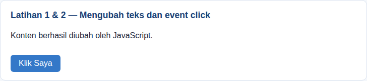

## Latihan 2 — Event click
Saat tombol diklik, paragraf menampilkan waktu klik.
```js
tombol.addEventListener("click", function () {
  pesan.textContent = "Tombol diklik pada " + new Date().toLocaleTimeString();
});
```
Sebelum klik:


Sesudah klik:
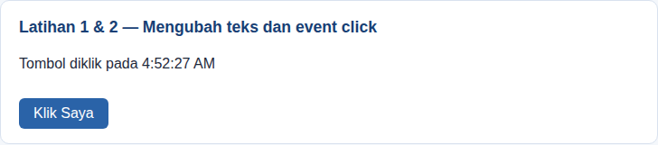

## Latihan 3 — Mengubah kelas dan gaya CSS
`classList.toggle()` menambah atau menghapus class `highlight` dan `teks-besar`.
```js
tombolGaya.addEventListener("click", function () {
  teksGaya.classList.toggle("highlight");
  teksGaya.classList.toggle("teks-besar");
});
```
Sebelum:


Sesudah klik tombol toggle:
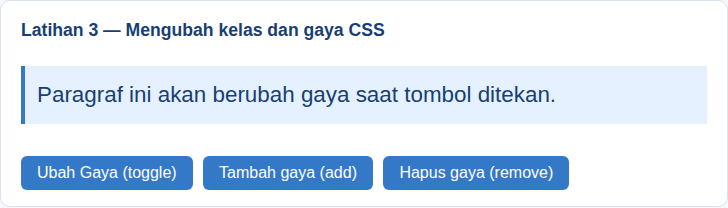

**Perbedaan `classList.add()`, `classList.remove()`, dan `classList.toggle()`** (sesuai instruksi modul untuk mengamati ketiganya):

| Method | Perilaku |
|---|---|
| `add()` | Menambahkan class. Jika sudah ada, tidak digandakan. |
| `remove()` | Menghapus class. Jika tidak ada, tidak terjadi apa-apa. |
| `toggle()` | Menambahkan class jika belum ada, menghapusnya jika sudah ada (membalik keadaan). |

Tombol "Tambah gaya (add)" setelah ditekan dua kali (class `highlight` tetap satu):
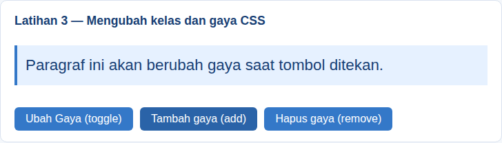

Tombol "Hapus gaya (remove)":
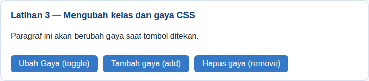

## Latihan 4 — Event input dan penghitung karakter
Jumlah karakter diperbarui setiap pengguna mengetik (event `input`).
```js
namaInput.addEventListener("input", function () {
  jumlahKarakter.textContent = namaInput.value.length;
});
```
Sebelum mengetik:
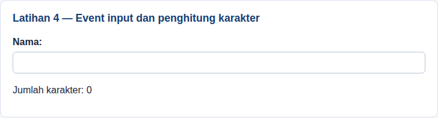

Setelah mengetik "Kartika Juliana" (15 karakter):
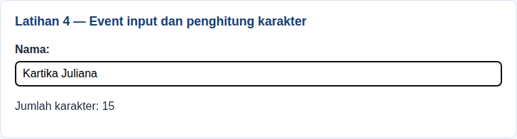

## Latihan 5 — Validasi form pendaftaran
Event `submit` memakai `preventDefault()`, `trim()`, regex email, dan pemeriksaan usia 17-100.

### Hasil pengujian

| No | Kondisi uji | Nama | Email | Usia | Hasil yang diharapkan | Hasil aktual |
|---|---|---|---|---|---|---|
| 1 | Semua kosong | (kosong) | (kosong) | (kosong) | Nama wajib diisi. | Nama wajib diisi. |
| 2 | Nama kosong | (kosong) | kartika@gmail.com | 20 | Nama wajib diisi. | Nama wajib diisi. |
| 3 | Email tidak valid | Kartika Juliana | kartika@ | 20 | Masukkan email yang valid. | Masukkan email yang valid. |
| 4 | Usia di bawah 17 | Kartika Juliana | kartika@gmail.com | 15 | Usia harus berupa bilangan bulat 17–100. | Usia harus berupa bilangan bulat 17–100. |
| 5 | Semua valid | Kartika Juliana | kartika@gmail.com | 20 | Validasi berhasil. Form siap diproses. | Validasi berhasil. Form siap diproses. |

Kondisi 1 — semua kosong:
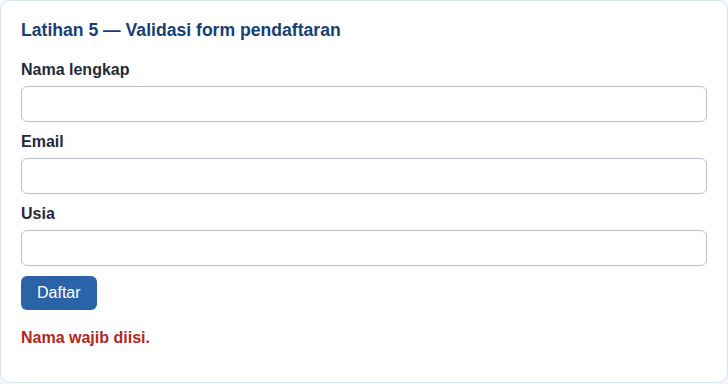

Kondisi 2 — nama kosong:
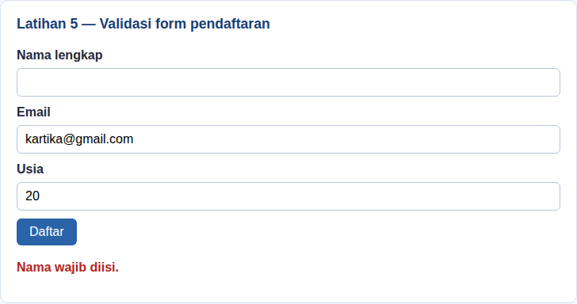

Kondisi 3 — email tidak valid:
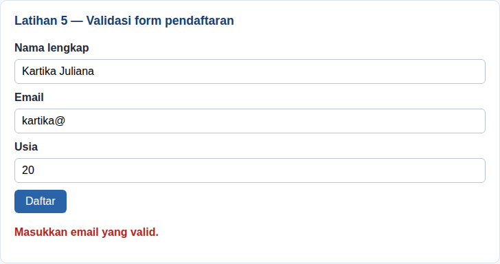

Kondisi 4 — usia di bawah 17:
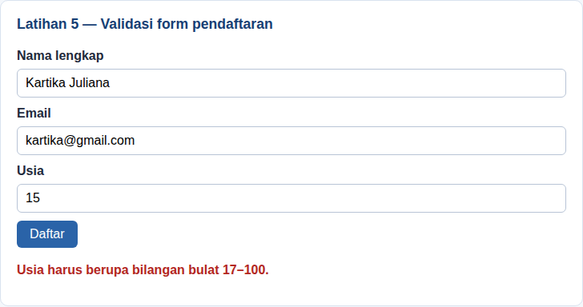

Kondisi 5 — semua valid:
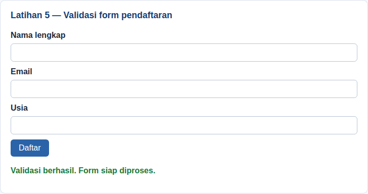

## Latihan 6 — Daftar tugas (To-do List)
Elemen dibuat dengan `createElement()`, teks tugas ditampilkan dengan `textContent`, dan status selesai diatur dengan `classList.toggle("selesai")`.

Awal:
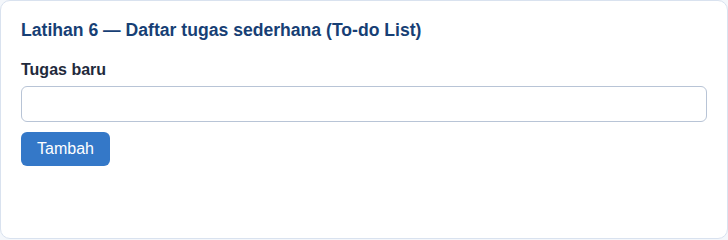

Tugas kosong ditolak:
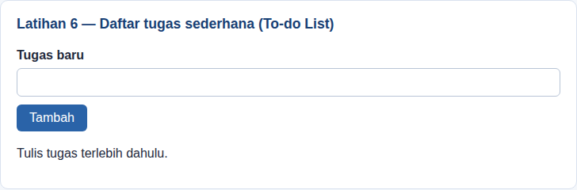

Setelah menambah tiga tugas dan menandai satu selesai:
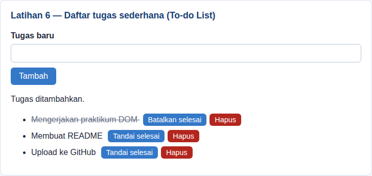

---

## Eksperimen Mandiri

### Eksperimen 1 — Tombol hapus item To-do List
Setiap item memiliki tombol "Hapus" yang memanggil `item.remove()`. Gambar: item ketiga sudah dihapus.
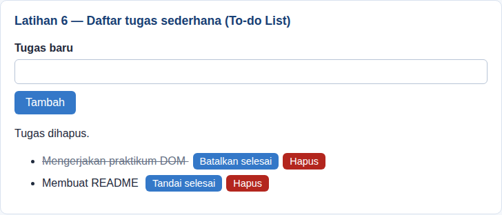

### Eksperimen 2 — Nama minimal 3 karakter
Validasi latihan 5 ditambah pemeriksaan `nama.length < 3`. Input "Ka" ditolak.
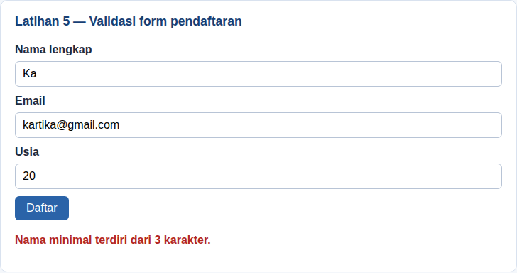

### Eksperimen 3 — Event change pada dropdown
Sebelum memilih:
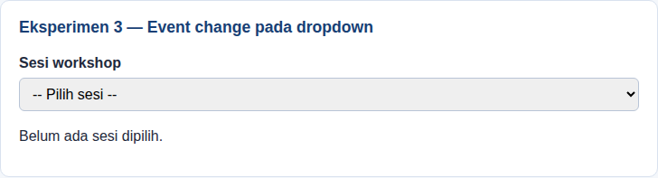

Sesudah memilih Sesi 2:
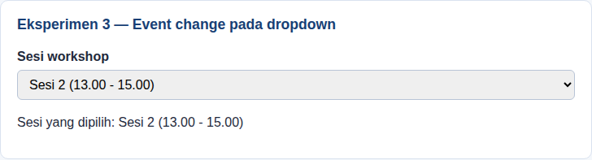

### Eksperimen 4 — Sembunyikan/tampilkan paragraf dengan class CSS
Memakai `querySelector()` dan `classList.toggle("tersembunyi")` (`.tersembunyi { display: none; }`).

Tampil:
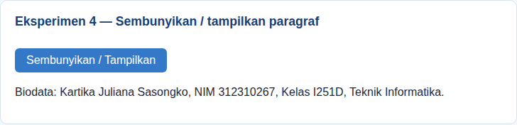

Tersembunyi:
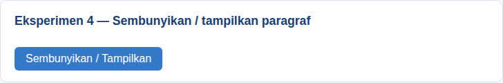

### Eksperimen 5 — Script di `<head>` tanpa `defer`
`eksperimen5.js` dimuat di `<head>` tanpa `defer`. Browser menjalankannya sebelum `<body>` selesai diparsing, sehingga `document.getElementById("tombolAksi")` menghasilkan `null`. Pemanggilan `null.addEventListener(...)` memunculkan error:

```
Uncaught TypeError: Cannot read properties of null (reading 'addEventListener')
```
Akibatnya tombol tidak berfungsi (paragraf tetap "Belum ada tindakan." setelah tombol diklik).

Tampilan halaman:
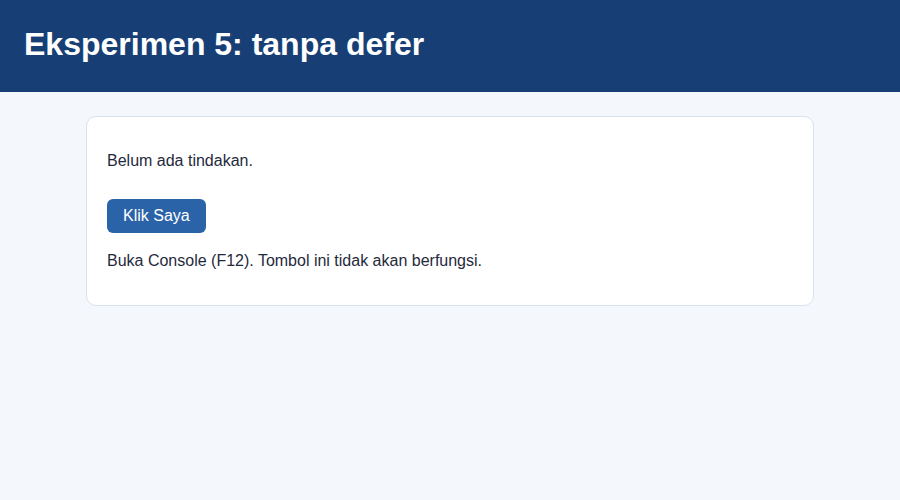

Output error (ditangkap otomatis dari browser, bukan tangkapan layar DevTools):
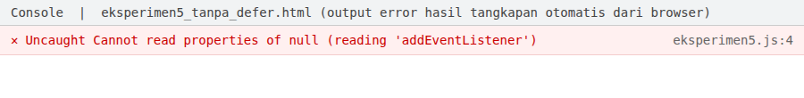

Solusi: tambahkan atribut `defer` pada tag `<script>`, atau letakkan script di akhir `<body>`.

---

## Mini Project — Form Pendaftaran Workshop (`mini_project_workshop/`)
Fungsi interaktif yang diimplementasikan:
1. **Validasi** nama (min. 3 karakter), email, dan pilihan sesi, dengan pesan error di bawah field yang bermasalah.
2. **Penghitung karakter** nama dan **ringkasan langsung** yang diperbarui lewat event `input` dan `change`.
3. **Pesan sukses dan ringkasan pendaftaran** yang ditampilkan dengan `textContent`.
4. **Tombol Reset** untuk mengosongkan input, pesan, dan hasil.

Tampilan awal:


Gagal validasi — semua kosong:
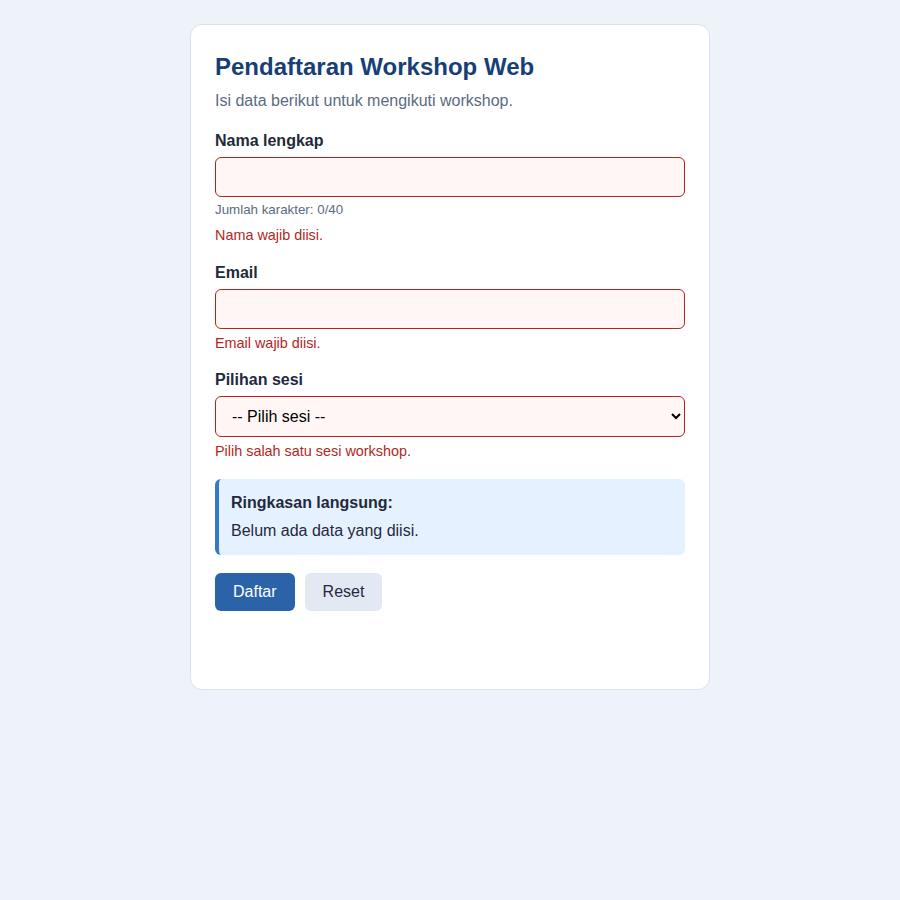

Gagal validasi — nama terlalu pendek dan format email salah:
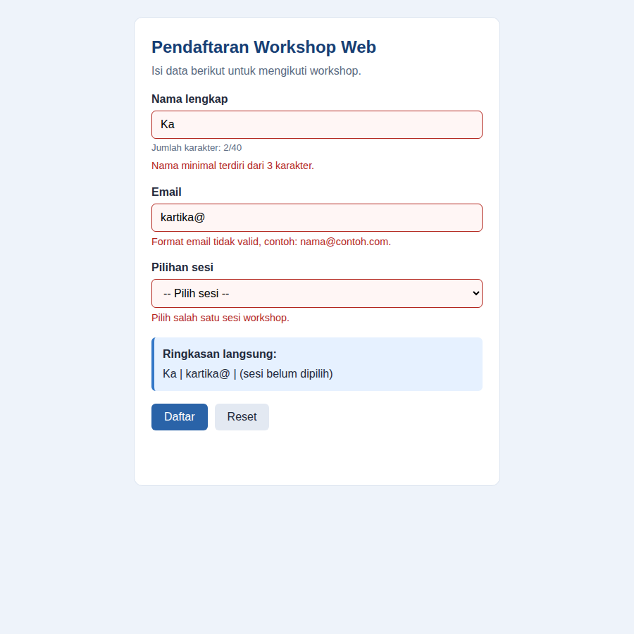

Berhasil:
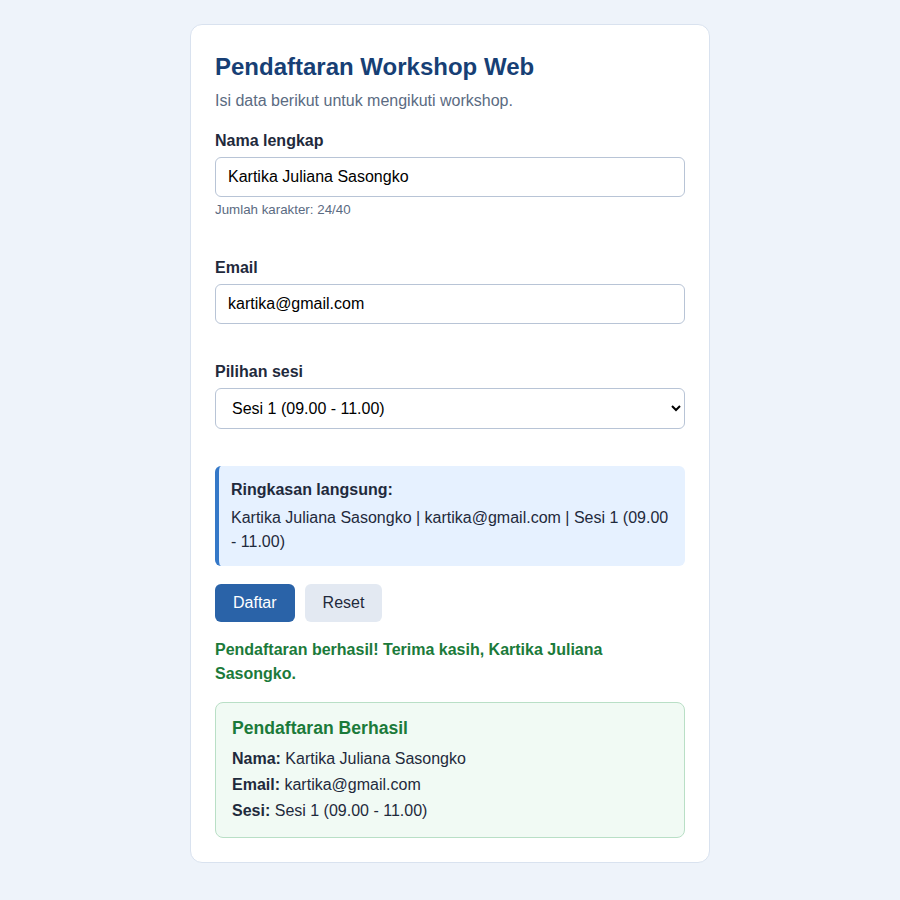

Setelah Reset:
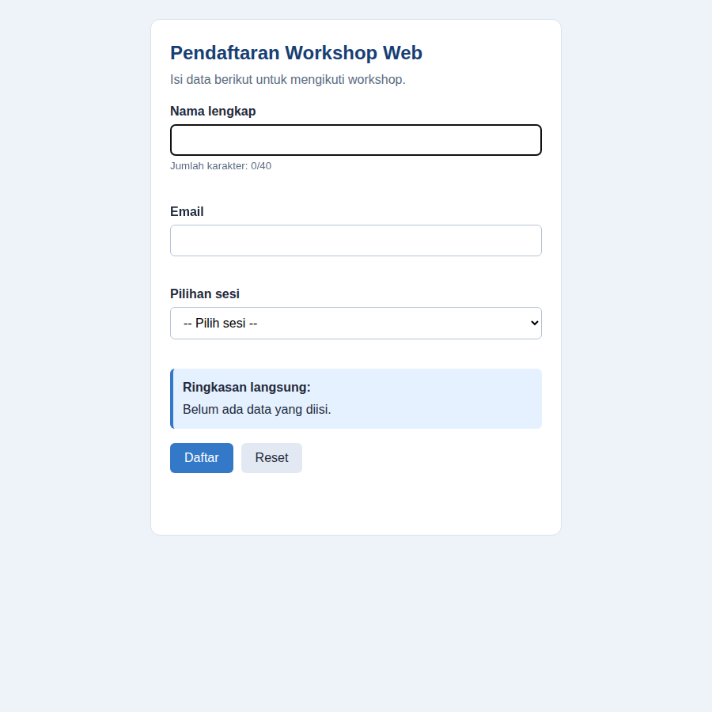

Tampilan mobile (lebar 390 px):

| Terisi | Gagal validasi | Berhasil |
|---|---|---|
| 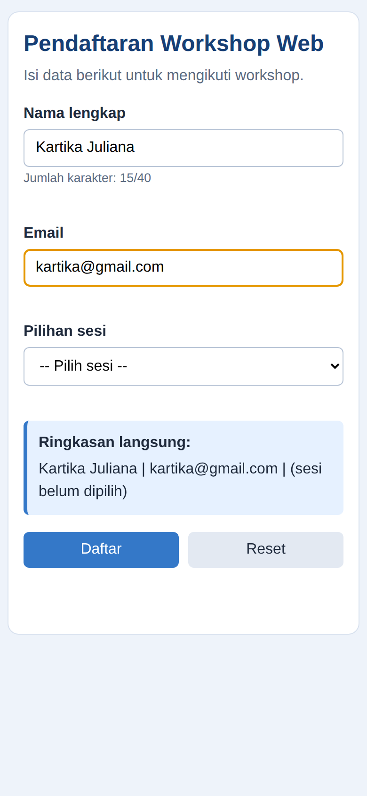 | 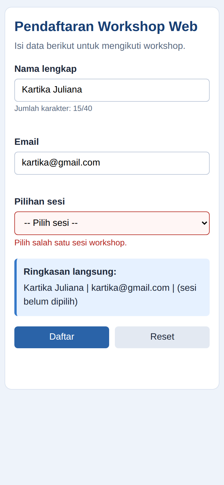 | 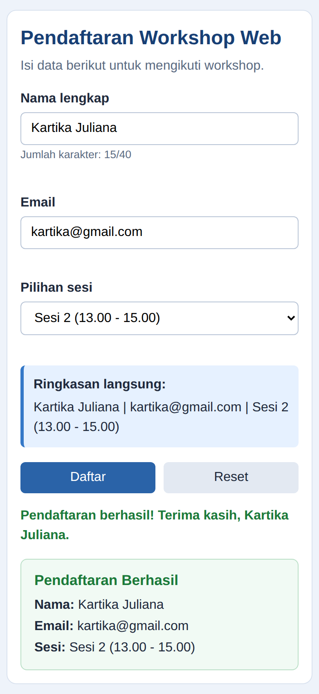 |

---

---

## Jawaban Pertanyaan Evaluasi

1. **Apa yang dimaksud dengan DOM dan apa manfaatnya?**
   DOM (Document Object Model) adalah representasi dokumen HTML dalam bentuk struktur pohon objek (parent, child, sibling) yang dapat diakses dan dimanipulasi oleh JavaScript. Manfaatnya: JavaScript dapat memilih elemen, mengubah teks, atribut, class, dan style, serta merespons tindakan pengguna, sehingga halaman berubah secara dinamis tanpa menulis ulang seluruh dokumen HTML.

2. **Apa perbedaan `getElementById()`, `querySelector()`, dan `querySelectorAll()`?**
   `getElementById()` memilih satu elemen berdasarkan id. `querySelector()` menerima selector CSS dan mengembalikan elemen pertama yang cocok (atau `null` jika tidak ada). `querySelectorAll()` menerima selector CSS dan mengembalikan `NodeList` berisi semua elemen yang cocok, yang dapat diproses dengan `forEach()`.

3. **Apa fungsi `addEventListener()` dan sebutkan tiga contoh event?**
   `addEventListener()` menghubungkan sebuah elemen dengan jenis event tertentu beserta fungsi handler yang dijalankan saat event terjadi, dengan pola `target.addEventListener(event, handler)`. Keunggulannya: logika JavaScript terpisah dari HTML dan beberapa listener dapat dipasang pada event yang sama. Contoh event: `click` (elemen diklik), `input` (nilai kolom berubah saat mengetik), dan `submit` (form dikirim).

4. **Mengapa `event.preventDefault()` digunakan pada event submit form?**
   Perilaku bawaan browser saat form dikirim adalah mengirim data dan memuat ulang halaman. `preventDefault()` membatalkan perilaku tersebut sehingga JavaScript dapat memvalidasi input, menampilkan pesan kesalahan atau hasil di halaman yang sama, dan menghindari reload sebelum pemeriksaan selesai.

5. **Apa perbedaan `textContent` dan `innerHTML` dari sisi penggunaan dan keamanan?**
   `textContent` membaca atau menetapkan teks murni; string yang berisi tag HTML ditampilkan apa adanya sebagai teks, sehingga aman untuk menampilkan input pengguna. `innerHTML` membaca atau menetapkan markup HTML sehingga tag diproses oleh browser. Jika input pengguna yang tidak tepercaya dimasukkan ke `innerHTML`, penyerang dapat menyisipkan HTML atau script (XSS). Karena itu utamakan `textContent`, dan gunakan `innerHTML` hanya jika markup memang diperlukan dan sumbernya tepercaya atau sudah disanitasi.

6. **Bagaimana `classList.toggle()` membantu mengubah tampilan elemen?**
   `classList.toggle()` menambahkan class jika elemen belum memilikinya dan menghapusnya jika sudah ada. Dengan satu pemanggilan, tampilan dapat dibalik (misalnya menyembunyikan atau menampilkan elemen dengan class `.tersembunyi`, atau menyorot teks dengan `.highlight`), sementara aturan tampilan tetap berada di CSS sehingga kode lebih rapi daripada mengubah banyak properti style secara langsung.

7. **Sebutkan minimal tiga skenario pengujian validasi form.**
   (1) Semua input kosong: sistem menampilkan pesan bahwa nama wajib diisi. (2) Email tidak valid, misalnya `kartika@`: sistem menolak dan menampilkan pesan format email. (3) Usia di bawah batas (15) atau di atas batas (101): sistem menolak dengan pesan rentang usia. (4) Nama hanya berisi spasi atau kurang dari 3 karakter: ditolak berkat `trim()` dan pemeriksaan panjang. (5) Semua input valid: sistem menampilkan pesan sukses. Seluruh skenario ini sudah diuji pada bagian Latihan 5 dan Eksperimen 2.

## Catatan
Validasi di sisi browser tidak menggantikan validasi di sisi server. Pada aplikasi nyata, data tetap harus diperiksa ulang di server.
